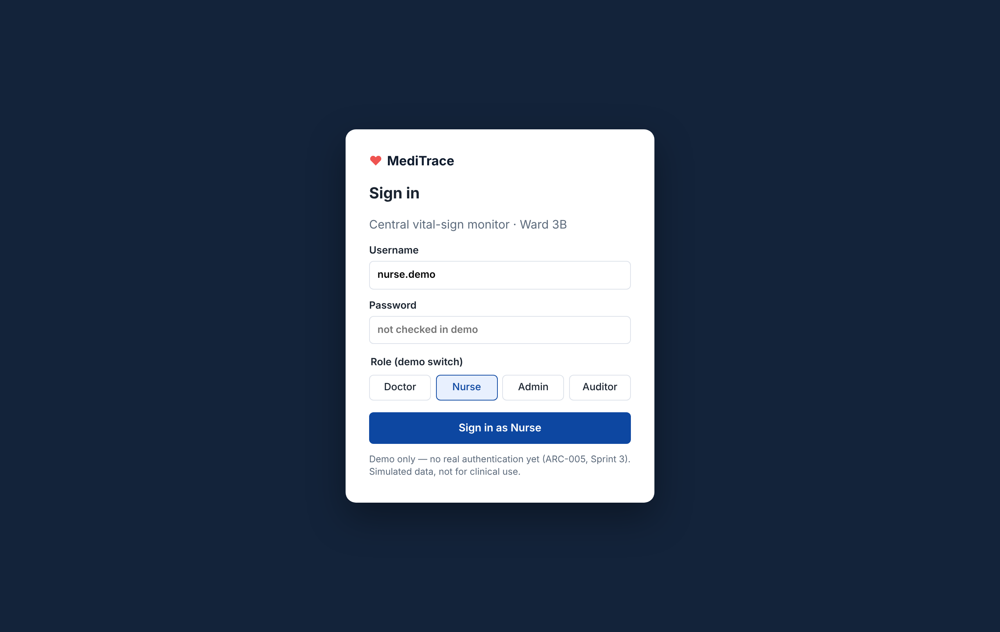
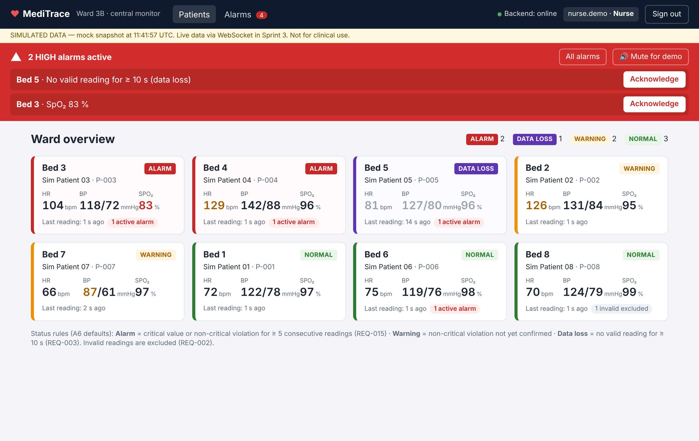
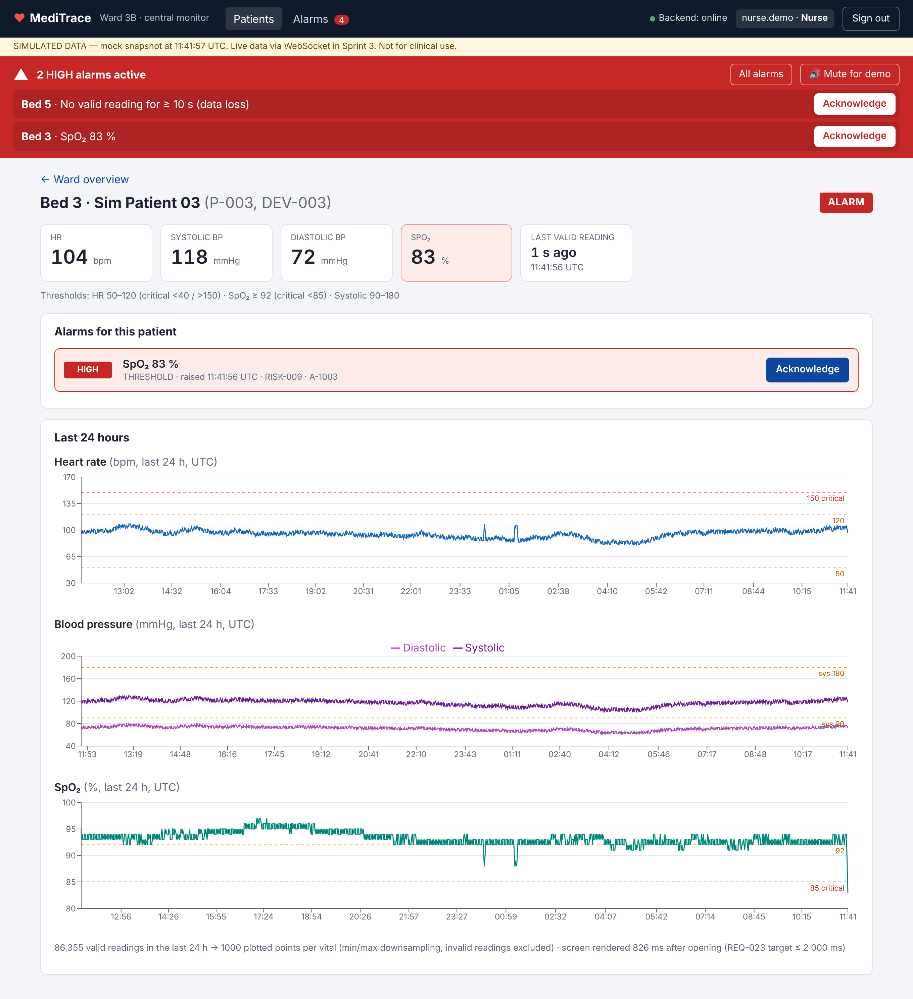
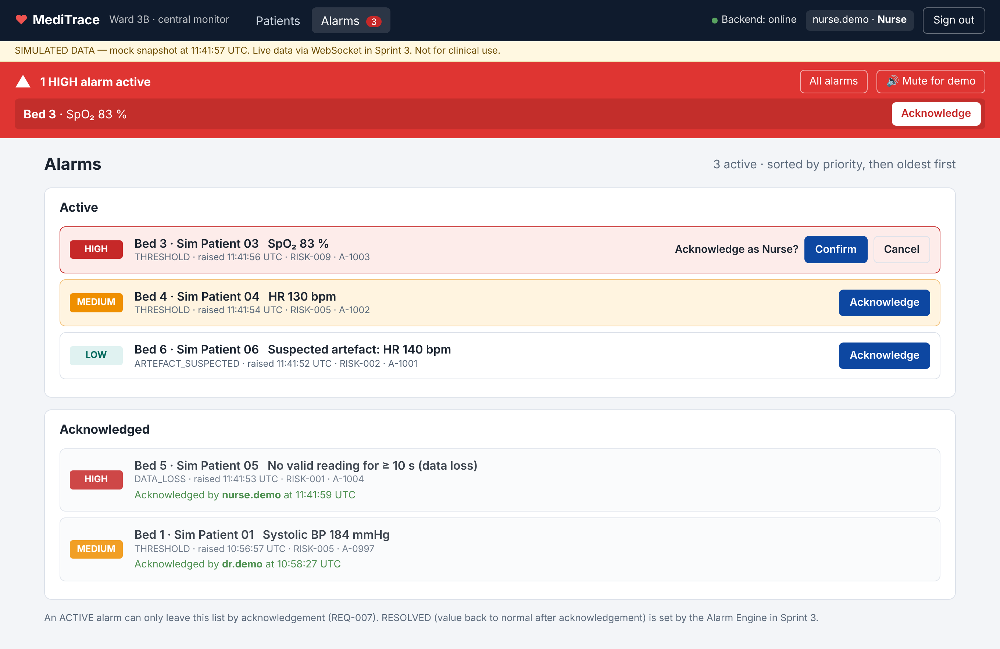

# MediTrace — Dashboard screens (PLN-06, ARC-008)

These screenshots of the working Sprint 2 skeleton replace separate wireframes. All data is **simulated
mock data** (`frontend/src/mock/`); the header strip says so on every screen. Default thresholds are the
educational defaults of the SRS (HR 50–120, critical < 40 / > 150; SpO₂ ≥ 92, critical < 85; systolic
90–180, no critical level). Screenshots: 1360 × 860 viewport, Chromium, 14.11.2026, backend `/health`
running (badge "online").

Common elements on every clinical screen (Doctor, Nurse):
- **Header:** navigation allowed for the role, backend `/health` badge, user and role, sign out.
- **Mock-data strip:** snapshot time in UTC, "not for clinical use".
- **HIGH-alarm banner** (REQ-005, REQ-022): red, pulsing (static with *reduced motion*), one row per active
  HIGH alarm with its own *Acknowledge* button, audible three-pulse beep (Web Audio API) every 2.5 s with a
  *Mute for demo* toggle. It disappears only when every HIGH alarm is acknowledged (REQ-007).

---

## 1. Login — `docs/test/screens/01-login.png`

- Username, password and a **role switch** (Doctor, Nurse, Admin, Auditor) for the demo. There is **no real
  authentication** yet — the password is neither checked nor sent; Argon2, lockout and JWT come with ARC-005
  in Sprint 3 (REQ-008, REQ-009).
- After sign-in each role lands on its first permitted screen: Doctor/Nurse → ward overview, Admin → devices
  & users, Auditor → logs. The click on *Sign in* also unlocks browser audio for the alarm sound.
- Role permission matrix (SRS / A6) applied in the UI: only Doctor/Nurse see patients, vitals and alarms and
  the *Acknowledge* button; only Doctor sees *Edit thresholds*; Admin sees device pairing; Doctor and Auditor
  see the hazard log; Auditor sees the audit log. Forbidden routes show "403 — Not permitted". This only
  hides controls; enforcement is server-side (ARC-005).

## 2. Ward overview (patient list) — `docs/test/screens/02-patient-list.png`

Serves: REQ-002, REQ-003, REQ-015 (display), REQ-005 (banner), REQ-022 (acknowledge from here).

- One **card per patient**: bed, pseudonymous name and ID, latest valid HR, systolic/diastolic BP and SpO₂
  (a value outside a limit is coloured amber, a critical value red), coloured **status** with a text label (not
  colour only), **time since last valid reading**, number of active alarms, number of invalid readings
  excluded.
- Status rules (same as the Alarm Engine): **Alarm** = latest value critical, or a non-critical violation for
  ≥ 5 consecutive valid readings · **Warning** = non-critical violation not yet confirmed · **Data loss** = no
  valid reading for ≥ 10 s · **Normal** otherwise. Invalid readings are ignored.
- Cards are sorted most urgent first (alarm, data loss, warning, normal); a legend shows the counts.
- Mock ward: Bed 3 critical SpO₂ 83 % (HIGH), Bed 4 HR > 120 for 7 readings (MEDIUM), Bed 5 silent for 14 s
  (data loss, HIGH), Beds 2 and 7 warnings (3 and 2 violating readings), Bed 6 suspected artefact (LOW),
  Bed 8 with one implausible reading HR 350 excluded, Bed 1 normal.

## 3. Patient detail — `docs/test/screens/03-patient-detail.png`

Serves: REQ-014 (24-h chart), REQ-023 (render time), REQ-007 (acknowledge here too), REQ-006 (Doctor-only
button, disabled until Sprint 3).

- Tiles with the latest HR, systolic BP, diastolic BP and SpO₂ (coloured by level) and the time of the last
  valid reading; the default thresholds are listed.
- Active and acknowledged alarms of this patient.
- **24-hour charts** for HR, blood pressure (systolic + diastolic) and SpO₂ with the threshold lines. The mock
  history has 86 400 readings per vital (1 Hz × 24 h); only valid readings in [now − 24 h, now] are used and
  each series is **downsampled to ≤ 1 000 points with min/max buckets** so that short extremes (e.g. a brief
  desaturation) stay visible.
- The footer shows the number of readings, the plotted points and the **measured time from opening the
  screen to the rendered charts** (browser Performance API) as REQ-023 evidence.

## 4. Alarm screen — `docs/test/screens/04-alarms.png`

Serves: REQ-005 (priorities, banner, sound), REQ-007 (acknowledgement), REQ-022 (≤ 2 clicks).

- **Active alarms sorted HIGH → MEDIUM → LOW**, oldest first within a priority, each with priority colour,
  bed, value, alarm kind, time raised (UTC), RISK ID and alarm ID.
- The **only** control of an active alarm is *Acknowledge* → inline question **"Acknowledge as <role>?"** →
  *Confirm* (or *Cancel*). 2 clicks. There is no close/dismiss button, and navigating away does not clear an
  alarm.
- Acknowledged alarms move to the *Acknowledged* list with **"Acknowledged by <user> at <time> UTC"**.
- In the screenshot the Bed 5 data-loss alarm was acknowledged by `nurse.demo`, and the confirmation for the
  Bed 3 HIGH alarm is open.
- *RESOLVED* (value back to normal after acknowledgement) will be set by the Alarm Engine in Sprint 3.

## Additional screens (not required for PLN-06)

- **Devices & users** (Admin): read-only device pairing table incl. an unpaired device, role matrix.
- **Logs** (Doctor, Auditor): mock hazard log with event type and RISK ID; audit log placeholder (Auditor).

## Known limitations of the skeleton

- Mock snapshot: values and "time since last reading" do not update live; live updates arrive with the
  REST API and `WS /ws/alarms` in Sprint 3.
- The alarm sound is a simple demo pattern, not the IEC 60601-1-8 high-priority melody.
- Acknowledgements are kept only in the browser session (no API, no audit entry yet).
